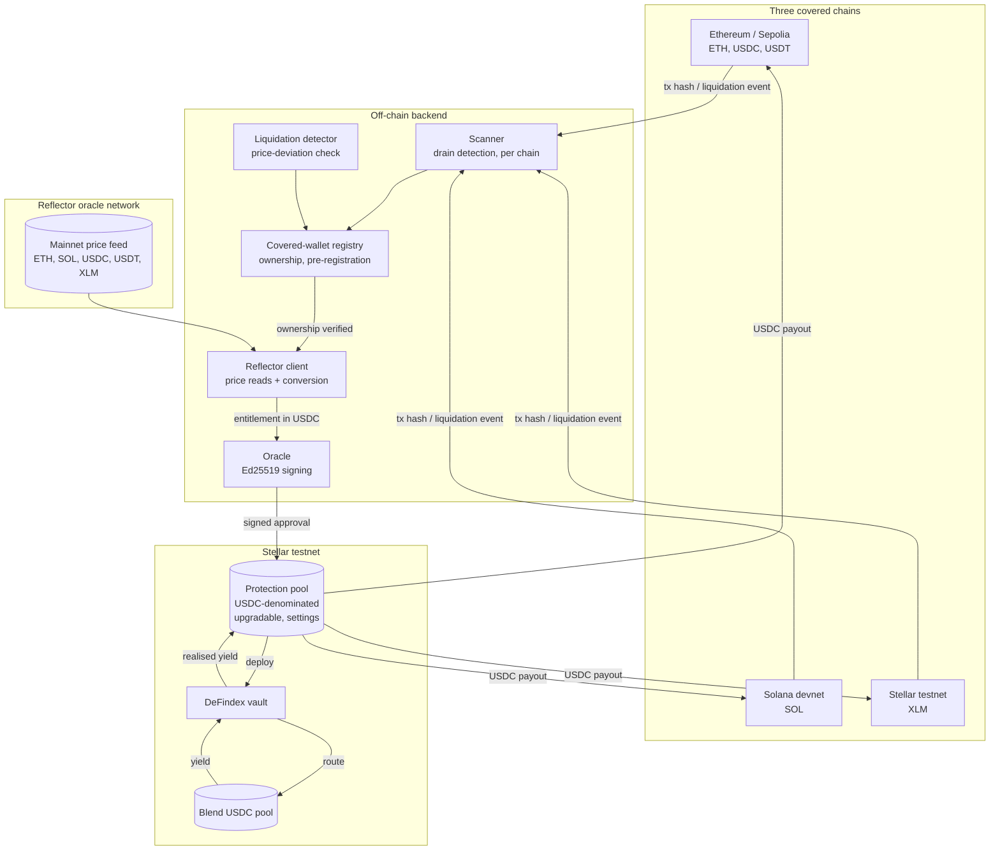
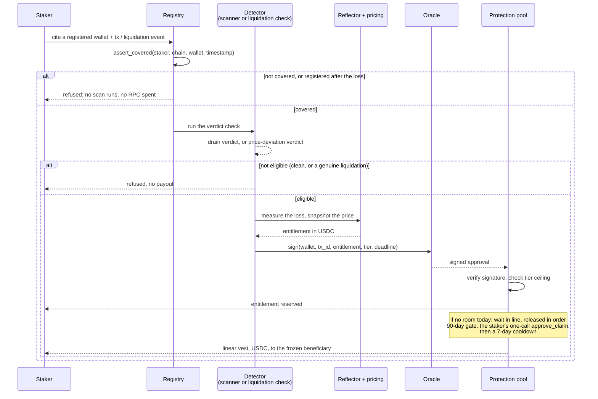
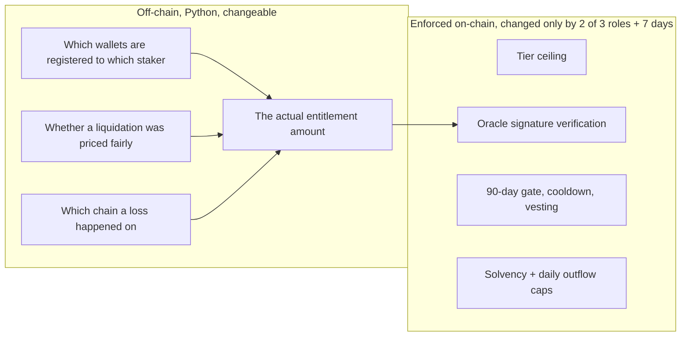

# Architecture

## System

## Claim sequence: either attack type, one signer

Both attack types, a wallet drain and a wrongful liquidation, produce the same shape of signed approval and go through the same contract path from here. The detector differs; nothing downstream of it does.

## Trust boundary

The contract never learns what was lost, on which chain, or why a liquidation was ruled wrongful. It verifies one signed number against a ceiling it can never exceed. Everything that decides that number lives off-chain and can be corrected without touching the deployed contract, the same on-chain/off-chain split SAFU's mainnet pool already runs on. The on-chain limits themselves are settings with hard bounds; changing one takes two of the three roles and 7 days in public.

## What's forked, and what never changes

The `protection-pool` contract here started as a copy of the Soroban pool already live on Stellar mainnet. That original stays at its frozen WASM hash; nothing in this repository ever writes to it. This version adds, built and tested the same way as the rest of the pool:

- An upgrade path and storage versioning, behind two-of-three governance and a 7-day public delay
- About two dozen bounded settings, including the tier ceilings, the claim window and the time gate, snapshotted onto each stake or claim
- Yield for stakers and backers through a growing index, a pending-yield view, and points as dollar-days
- Stake overflow into backing, a daily backer withdrawal drip, and per-deposit maturity
- A first-come claim line with a fair daily share for every streaming claim, and capped upkeep inside every user call
- A rounding reserve so the last staker can always exit, and a vault setup script that seeds and fully invests the vault before the pool goes live
